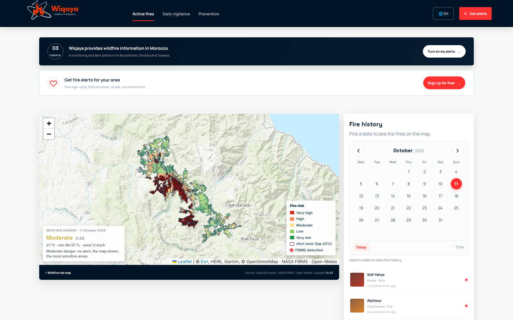
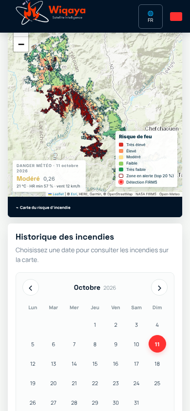

# Wiqaya — Wildfire risk monitoring for Moroccan forests

**Wiqaya** (وقاية, *"prevention"*) is a wildfire monitoring and alert platform for the forests of
**Bouhachem, Derdara and Jbel Sougna** (Rif, northern Morocco). It combines a machine-learning fire-risk
model, live weather and NASA satellite fire detections on one map, in **French, English and Arabic**.



## What the website does

| | |
|---|---|
| **Daily fire-risk map** | The forest is split into **6,071 cells of 250 m**. Each cell gets a fire susceptibility from the model, grouped into 5 risk classes. The 20 % riskiest cells are outlined as *alert zones*. Clicking a cell shows why: susceptibility, years since the last fire, elevation, slope and population. |
| **Weather danger of the day** | Today's forecast from Open-Meteo (max temperature, min humidity, max wind, max vapour-pressure deficit) is compared with every summer day from 2017 to 2024. This gives a danger index from 0 to 1 (low / moderate / high / very high). Alerts become operational when the danger is high or very high. |
| **Fire history** | Pick any date in the calendar to see the **NASA FIRMS** satellite fire detections of that day on the map (MODIS since 2005, VIIRS since 2017). |
| **Alert sign-up** | Citizens subscribe to SMS and email alerts for their forest. Subscriptions are stored by the server. |
| **3 languages** | French, English and Arabic. Arabic uses a full right-to-left layout. The choice is remembered, and `?lang=en`, `?lang=ar` or `?lang=fr` can be added to any link. |

| Risk map and weather danger | Fire history: 25 July 2022, start of the Bouhachem fire |
|---|---|
|  |  |

| Cell details | Alert sign-up |
|---|---|
|  |  |

| Arabic (right-to-left) | Mobile |
|---|---|
|  |  |

## Quick start

You need Python 3.11 or newer and an internet connection, for the weather and the map background.

```bash
git clone https://github.com/SanaeBelfrouh/wiqayagit.git
cd wiqayagit
git checkout wiqaya-hackathon

python -m venv .venv
source .venv/bin/activate            # Windows: .venv\Scripts\activate
pip install -r server/requirements.txt

python server/app.py
```

Then open **http://localhost:8000**. The full-screen map is at **http://localhost:8000/carte.html**.

The first start prepares the model, which takes 3 to 5 minutes. It builds the grid, computes terrain
features, reads FIRMS and runs the validation. The result is cached in `server/cache/`, so later starts
take a few seconds. The cache is rebuilt automatically when a file in `data/` changes.

## How the model works

### Research model (`model/code208_risque_feu_autonome.ipynb`)

The full notebook models the risk on a 250 m grid in Merchich / Nord Maroc (EPSG:26191). It separates two questions:

- **Where?** A *spatial model* compares burned and unburned cells on the same fire day. It is trained on
  8 documented fires between 2005 and 2022:
  - 2005, 2009a and 2009bc, labelled with Landsat;
  - Tanaqoub 2019a and 2019b, Bouhachem 2020, Derdara 2021 and Bouhachem 2022, labelled with Sentinel-2.

  Burned areas come from the dNBR (Sentinel-2 / Landsat). The two 2025 fires are kept as a blind test.
- **Which day?** A *weather danger index* compares the day's weather with the 2017–2024 summers.
- **Yearly susceptibility map.** It is learned from FIRMS detections year by year, with leave-one-year-out validation.

The notebook uses 29 inputs:
- terrain: elevation, slope, aspect, and the topoclimate index of Assali et al. (2016);
- vegetation: 2021 land cover, flammability from NDVI and NDMI;
- satellite indices: NBR, NBR trend;
- human pressure: distances to roads, tracks, buildings, villages and farmland (OpenStreetMap), plus population;
- fire history: past fire density and power (FIRMS);
- daily weather (Open-Meteo).

Every input and formula is documented in [`docs/inputs_modele_risque_feu.pdf`](docs/inputs_modele_risque_feu.pdf) (in French; its file paths refer to the original project layout).

### Web model (`server/modele.py`)

The website runs the parts of the notebook that work with the data in this repository, with the same
formulas and parameters:

| Step | Notebook | Website |
|---|---|---|
| Single 250 m grid over the 6 forest parts | ✅ | ✅ 6,071 cells |
| Elevation, slope, aspect (DEM), population (WorldPop 2017) | ✅ | ✅ |
| Years since last fire + fuel rule (no fuel the year after a fire, half risk for 1 to 5 years) | ✅ | ✅ from FIRMS points |
| Land cover, OpenStreetMap distances | ✅ | ❌ input files not in the repository yet |
| Sentinel-2 / Landsat indices and dNBR burned areas | ✅ | ❌ about 2 h of image downloads, not suited to a web server |
| Yearly susceptibility model, leave-one-year-out validation | ✅ | ✅ the better of logistic regression and random forest |
| Weather danger index (Open-Meteo, 2017–2024 summer climatology) | ✅ | ✅ |
| Daily map: 5 KMeans classes + top-20 % alert zones | ✅ | ✅ |

The operational model is retrained on every complete year of FIRMS data (2017–2025). It is then
applied at today's date, using the fire history known on that day.

### Evaluation and limitations

The validation and test scores are returned by the API in `resume.modele`:

- **Leave-one-year-out validation (2017–2024):** mean ROC-AUC of **0.62** per year. Logistic regression is selected.
- **Blind test on the 2025 fires** (model trained on 2017–2024): ROC-AUC of **0.25**. The 2025 fires broke out
  in areas the reduced model ranks as low risk.

The reduced web model is therefore a **working pipeline, not yet a reliable predictor**. The most
important features (elevation, recent burns, aspect) describe terrain and history, but not vegetation
or human access. Planned next steps:

1. Add the 2021 land-cover raster and the OpenStreetMap distance layers. These are the main inputs of the notebook that are still missing here.
2. Add the satellite vegetation indices (NDVI, NDMI, NBR), computed offline once a day.
3. Connect the alerts to a real SMS / email service and to an official fire feed. The "active fires" list on the home page is still demo data.

## API

| Route | Returns |
|---|---|
| `GET /api/risque[?date=YYYY-MM-DD]` | Risk cells as GeoJSON (WGS 84): `susceptibilite`, `classe_risque` (1–5), `alerte_feu`, terrain and history fields. `resume` holds the weather danger, the model name, its validation and test scores and its feature importance. |
| `GET /api/feux?date=YYYY-MM-DD[&jours=N]` | NASA FIRMS detections within 5 km of the forest |
| `GET /api/foret` | Outline of the 6 forest parts |
| `POST /api/trpc/alerts.subscribe` | Alert sign-up used by the website form. Stored in `server/cache/inscriptions.jsonl`, which is not versioned. |

Environment variables:

| Variable | Default | Purpose |
|---|---|---|
| `PORT` | `8000` | Server port |
| `HOST` | `127.0.0.1` | Listening address |
| `WIQAYA_DATA` | `data` | Data folder |
| `WIQAYA_CACHE` | `server/cache` | Cache folder |

## Repository structure

```
├── website/                            Website (HTML / CSS / JavaScript)
│   ├── index2.html                     Home page
│   ├── carte.html                      Full-screen risk map
│   ├── carte-risque.js / .css          Risk map (Leaflet)
│   ├── i18n.js                         French / English / Arabic translations
│   └── wiqaya.js / wiqaya.css          Page interactions and styles
├── server/                             Python server (FastAPI)
│   ├── app.py                          Website + API
│   ├── modele.py                       Fire-risk model used by the website
│   └── requirements.txt
├── model/                              Full research notebook (code208) and how to run it
├── data/                               GIS inputs, all in EPSG:26191
│   ├── forest/limites_forets.shp       Forest boundaries (6 parts)
│   ├── dem/mnt_bouhachem.tif           Digital elevation model
│   ├── firms/                          NASA FIRMS fire detections (MODIS, VIIRS)
│   └── population/                     WorldPop 2017, clipped to the study area
└── docs/                               Screenshots and model-inputs documentation
```

## Data sources

| Data | Source | Licence |
|---|---|---|
| Active fire detections | [NASA FIRMS](https://firms.modaps.eosdis.nasa.gov/) (MODIS C6.1, VIIRS S-NPP) | NASA open data |
| Weather and climatology | [Open-Meteo](https://open-meteo.com/) | CC BY 4.0 |
| Population 2017 | [WorldPop](https://www.worldpop.org/) `mar_ppp_2017`, clipped and reprojected | CC BY 4.0 |
| Map background | Esri World Topo Map (fallback: OpenTopoMap) | Esri terms / CC BY-SA |
| Topoclimate method | Assali et al. (2016), Chefchaouen-Ouazzane | — |

The full WorldPop raster (268 MB) is not stored here because it is over GitHub's 100 MB limit.
The repository keeps the 100 m version clipped to the forest plus a 10 km buffer (966 KB). Clipping and
reprojection keep the population totals within 0.1 %.
