# Wiqaya — Wildfire risk mapping and alerts for the forests of northern Morocco

**Team:** Wiqaya (Morocco) · **Theme:** Climate & Disaster Resilience · **Arab Youth Space Hackathon 2026, Proof of Concept**

**Wiqaya** (وقاية, *"prevention"*) turns 20 years of NASA FIRMS satellite fire detections, terrain and population data
into a **250 m fire-susceptibility map** of the Bouhachem, Derdara and Jbel Sougna forests (25,900 ha). It adds a
**daily weather danger index** and delivers both to forest managers and residents through a trilingual web platform
(English, French, Arabic).

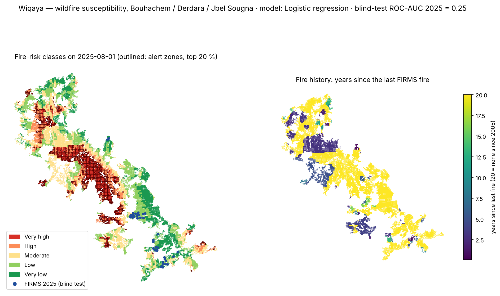

**Contents:**
1. [Business use case](#1-business-use-case)
2. [Problem](#2-problem)
3. [Data used](#3-data-used)
4. [Technical approach](#4-technical-approach)
5. [Installation](#5-installation)
6. [How to run](#6-how-to-run)
7. [Example input and output](#7-example-input-and-output)
8. [Results and limitations](#8-results-and-limitations)
9. [Team, licence and attribution](#9-team-licence-and-attribution)

---

## 1. Business use case

| | |
|---|---|
| **Users** | Forest managers of the national forestry agency (ANEF), Civil Protection, provinces and communes in the Rif. Residents of the villages (*douars*) inside and around the forest. |
| **Decision** | Each summer morning: **where** to send patrols, watch-tower crews and first-intervention teams, and **whether** today is dangerous enough to warn residents and restrict risky activities (burning, BBQs, works). |
| **What they use today** | Province-scale fire-danger bulletins, field knowledge, and satellite fire detections (NASA FIRMS, EFFIS) that arrive only **after** a fire has started. There is no public, cell-level, daily view of risk, and alerts do not reach residents in Arabic and French. |
| **What Wiqaya gives them** | A 250 m risk map with the 20 % riskiest cells outlined as alert zones and an explanation for each cell, a daily weather danger index, the full fire history on a calendar, SMS / email alert sign-up, and an open GeoJSON API for their own GIS tools. |
| **Business model** | Subscription per protected area for institutions (dashboard, API, alert dispatch). Free citizen alerts, funded by the institutional contracts or by CSR partners. Built on open data, so there is no imagery cost for the base service. |

## 2. Problem

- **The western Rif burns almost every summer.** Hot, dry *chergui* winds, steep slopes and villages inside the forest
  make fires fast and dangerous. In and around the study area:
  - Bouhachem, July 2022: more than 7,500 ha;
  - Larache / Sahel El Menzla, July 2022: more than 10,500 ha;
  - Derdara, 2021: about 1,100 ha;
  - Bouhachem, 2020: about 1,100 ha;
  - two new fires in August 2025.
- **People are exposed.** WorldPop 2017 counts about **10,600 inhabitants inside the forest** and **264,000 within 10 km**.
- **The information gap.** Danger bulletins are coarse (province scale). Fire detections come after ignition. No product
  says *which 250 m cells* deserve attention *today*.
- **Why satellite data is the right instrument:**
  - NASA FIRMS has recorded every active fire here since 2005 (MODIS) and at 375 m since 2017 (VIIRS). This gives the
    only consistent, 20-year, wall-to-wall fire history of these remote mountains.
  - Elevation models and gridded population cover the same area uniformly.
  - Sentinel-2 and Landsat measure vegetation and burned areas (research notebook).
  - Field records cannot provide this coverage.

## 3. Data used

| Dataset | Product and provider | Dates | Processing level | Licence | Used in |
|---|---|---|---|---|---|
| Active fires | **NASA FIRMS**: MODIS Collection 6.1 active fires (1 km) and VIIRS S-NPP 375 m Collection 2 active fires | 2005-05-09 → 2026-06-05 (1,176 detections within 5 km of the forest) | Level-2 active-fire points (archive and NRT), clipped to the AOI | NASA open data, no restriction | Main notebook, platform |
| Terrain | **FABDEM V1-2** (University of Bristol): Copernicus GLO-30 DEM with forests and buildings removed, 1 arc-second (≈30 m) | V1-2, January 2023 (Copernicus DEM 2021_1) | Bare-earth DEM, reprojected to EPSG:26191, clipped to the forest + 1 km; slope and aspect derived | CC BY-NC-SA 4.0 | Main notebook, platform |
| Population | **WorldPop** `mar_ppp_2017`, unconstrained, 3 arc-seconds | 2017 | Clipped to the forest + 10 km, reprojected to 100 m (sum resampling, totals within 0.1 %) | CC BY 4.0 | Main notebook, platform |
| Forest boundaries | 6-part forest polygon, prepared by the team | 2026 | Vector, EPSG:26191 | Shared with this repository | Main notebook, platform |
| Weather | **Open-Meteo** Historical Weather API (ERA5 / ERA5-Land reanalysis) and Forecast API: hourly 2 m temperature, 2 m relative humidity, 10 m wind | 2017-06-01 → 2025-09-30, plus today's forecast | Hourly → daily max / min, VPD computed | CC BY 4.0 | Main notebook (step 7), platform |
| Optical imagery | **Copernicus Sentinel-2 L2A** (B04, B08, B11, B12) via Microsoft Planetary Computer | 2015 → 2025, around each fire | Level-2A surface reflectance → NDVI, NDMI, NBR, dNBR | Copernicus open licence | Research notebook |
| Optical imagery | **Landsat Collection 2 Level-2** (USGS) via Microsoft Planetary Computer | 2005, 2009 | Surface reflectance → same indices | USGS public domain | Research notebook |
| Land cover | 2021 land-cover classification of the study area, prepared by the team | 2021 | 10 m raster → fuel class and flammability | team | Research notebook |
| Human access | **OpenStreetMap** roads, tracks, buildings, villages, farmland | 2022 | Distances per cell | ODbL | Research notebook |

**Hyperspectral data is not used in this PoC.** It is the first item of the incubation roadmap: EnMAP or Arab Satellite
813 scenes could map **live fuel moisture** and **vegetation species** at cell level. Those are the two drivers that the
current data capture only indirectly.

No API key, token or environment variable is needed: FIRMS data is committed, and Open-Meteo and Planetary Computer are
used anonymously.

## 4. Technical approach

The workflow below runs in this order in [`notebooks/02_main_analysis.ipynb`](notebooks/02_main_analysis.ipynb). The
code is in [`src/wiqaya_model.py`](src/wiqaya_model.py).

```
FIRMS points ─┐
DEM ──────────┼─► 250 m grid ─► features per cell ─► yearly panel 2017-2024 ─► leave-one-year-out ─► best model
WorldPop ─────┘   (6,071 cells)  elevation, slope,    (label = FIRMS fire       validation          │
                                  aspect, population,  in the cell that year)                        ▼
                                  years since last fire                     blind test 2025 ◄── retrain 2017-2024
                                                                                                     │
Open-Meteo (ERA5) ─► weather danger index of the day                    susceptibility map on 2025-08-01
                     (rank vs 2017-2024 summers)                         5 risk classes + top-20 % alert zones
```

1. **Grid.** One 250 m grid over the union of the 6 forest parts, with every cell clipped to the forest (EPSG:26191).
2. **Terrain and population.** Mean elevation, slope (%) and aspect per cell from the DEM. Aspect uses a circular mean, so
   355° and 5° give north. Population is the WorldPop count summed over the cell.
3. **Fire history.** A cell has burned on a day when a FIRMS detection falls within **375 m** (half a VIIRS pixel). The
   features `years_since_last_fire` (capped at 20) and `burned_last_5y` always use fires strictly **before** the date
   studied, so there is no leakage.
4. **Yearly panel.** One row per (cell, year) for 2017–2024: features on 1 January, label = at least one FIRMS
   detection in the cell that year. That gives 48,568 cell-years, 345 of them with a fire.
5. **Model selection.** Two candidates are compared with **leave-one-year-out** validation:
   - logistic regression (L2, C = 0.5, balanced classes, standardised features);
   - random forest (300 trees, depth 6, min. 10 samples per leaf, balanced).

   Seed 93. The best mean ROC-AUC per year wins.
6. **Fuel rule.** Predictions are set to 0 for cells burned less than 1 year ago, and halved for cells burned 1 to 5
   years ago.
7. **Blind test.** The selected model is retrained on 2017–2024 and scored on the 2025 FIRMS fires, with the fire history
   known on 1 August 2025.
8. **Risk map.** Susceptibility per cell on 2025-08-01, grouped into 5 classes by KMeans (`n_init` = 30). The riskiest
   **20 %** of cells become alert zones.
9. **Weather danger.** Daily max temperature, max vapour-pressure deficit (VPD = 0.6108·e^(17.27T/(T+237.3))·(1−RH/100)),
   max wind and min humidity are each ranked against all June–September days of 2017–2024. The index is the mean of the
   four ranks: low < 0.25 ≤ moderate < 0.50 ≤ high < 0.75 ≤ very high. On the platform, alerts become operational at
   *high* and *very high*.

The [research notebook](research/) extends this with a spatial "fire day" model trained on Sentinel-2 and Landsat dNBR
burned areas of 8 fires (2005–2022), using 29 inputs: NDVI, NDMI, NBR, flammability, the topoclimate index of Assali et
al. (2016), OpenStreetMap human pressure, and more. Every input and formula is documented in
[`docs/inputs_modele_risque_feu.pdf`](docs/inputs_modele_risque_feu.pdf), in French.

## 5. Installation

Requires **Python 3.11**.

```bash
git clone https://github.com/SanaeBelfrouh/wiqayagit.git
cd wiqayagit
python -m venv .venv && source .venv/bin/activate      # Windows: .venv\Scripts\activate
pip install -r requirements.txt
```

## 6. How to run

```bash
jupyter lab notebooks/02_main_analysis.ipynb
```

Run all cells. Nothing needs to be edited.
- **Runtime:** about **5 minutes** on a standard laptop, no GPU required.
- **Reads:** the four files of `data/sample_input/`.
- **Writes:** `results/`, with `results/example_output.png` as the headline figure.
- **Final cell:** prints the summary (validation and blind-test scores).
- **Optional parameter:** to study another date, change `ANALYSIS_DATE` in the first cell.
- **Internet:** steps 1–6 run offline. Step 7 (weather danger of the 2025 fire days) needs internet, and is skipped with a
  message if Open-Meteo does not answer.

Without Jupyter's interface:

```bash
jupyter nbconvert --to notebook --execute --inplace notebooks/02_main_analysis.ipynb
```

### Optional: the web platform

```bash
python server/app.py          # then open http://localhost:8000
```

The first start prepares the model in 3 to 5 minutes, then caches it in `server/cache/`. The site follows the browser
language (English, French or Arabic). The API is documented in [`server/README.md`](server/README.md).

## 7. Example input and output

**Input:** [`data/sample_input/`](data/sample_input/), 8.4 MB, clipped to the area of interest. See
[`data/README.md`](data/README.md) for the processing of each file.

| File | Content |
|---|---|
| `forest_boundaries.gpkg` | 6 forest parts, EPSG:26191 |
| `dem_30m.tif` | Digital elevation model, forest + 1 km |
| `population_2017_100m.tif` | WorldPop 2017, 100 m |
| `firms_fire_detections.gpkg` | 1,176 NASA FIRMS detections, 2005–2026 |

**Output:** everything below is produced by the notebook and committed in [`results/`](results/).

| File | Content |
|---|---|
| `example_output.png` | **Headline figure:** risk classes and alert zones on 2025-08-01 with the 2025 fires, and fire history |
| `validation_leave_one_year_out.csv` | Validation scores of both models, per year |
| `blind_test_2025.csv` | Blind-test scores on the 2025 fires |
| `risk_cells_2025-08-01.csv` | Susceptibility, class, alert and features of the 6,071 cells |
| `study_area_firms.png` | Study area and FIRMS detections by period |
| `feature_importance.png` | Feature importance of the selected model |

| Study area and FIRMS detections | Feature importance |
|---|---|
| 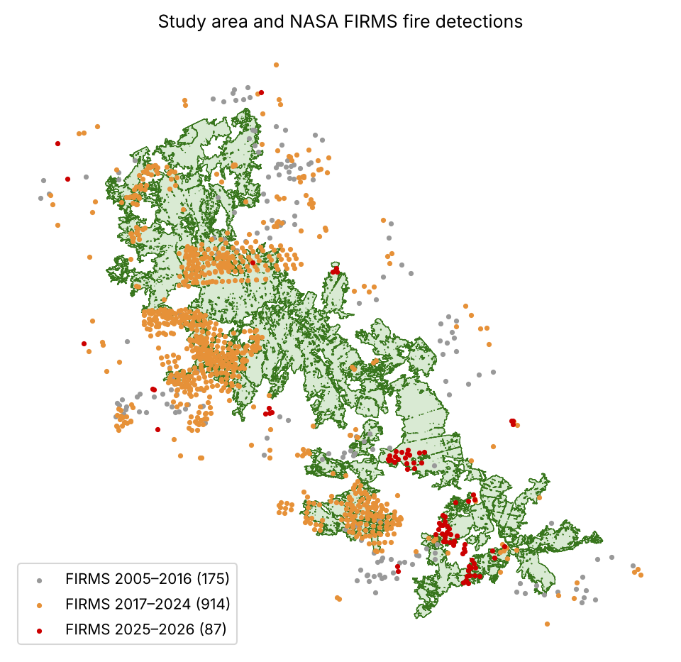 | 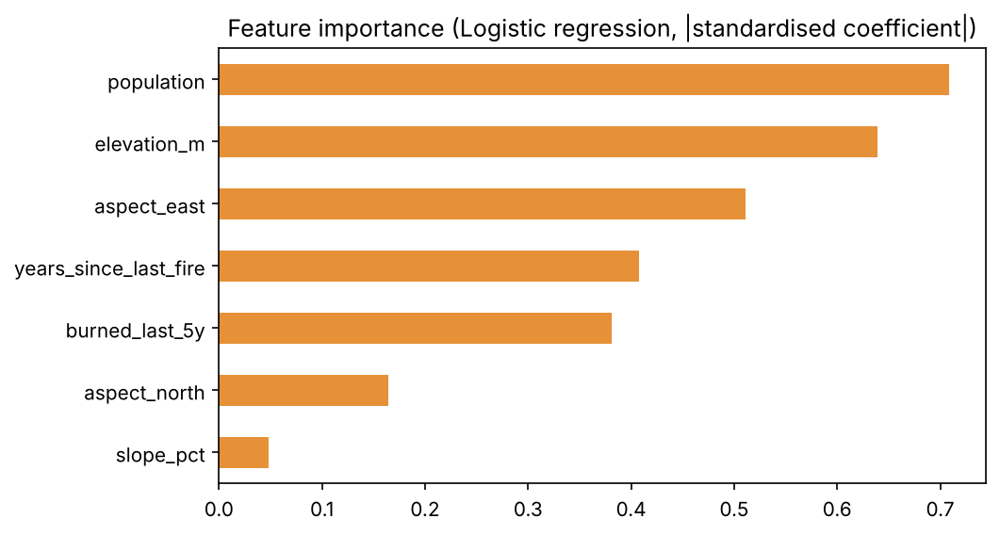 |

### The same model on the web platform

| Risk map and weather danger | Fire history: 25 July 2022, start of the Bouhachem fire |
|---|---|
| 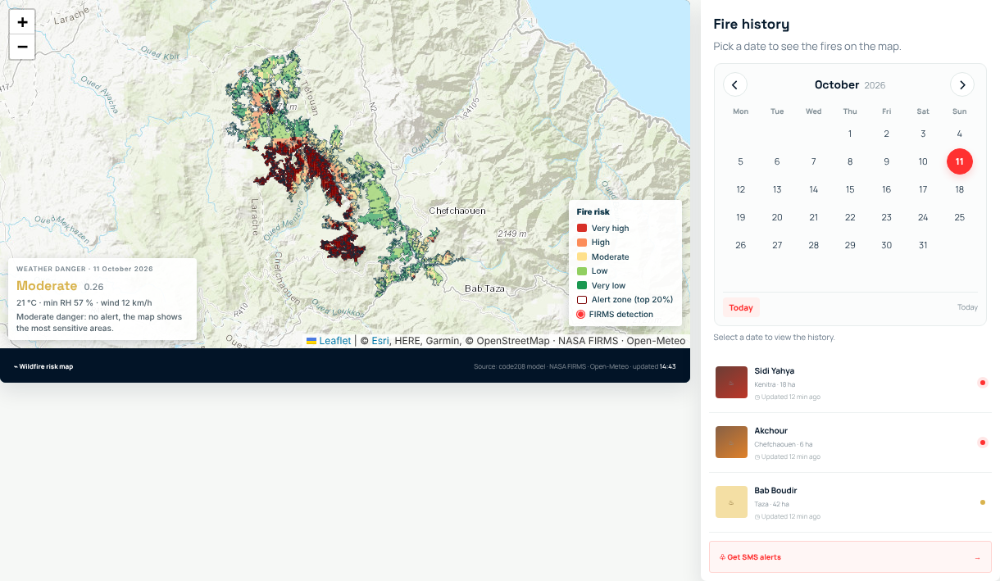 | 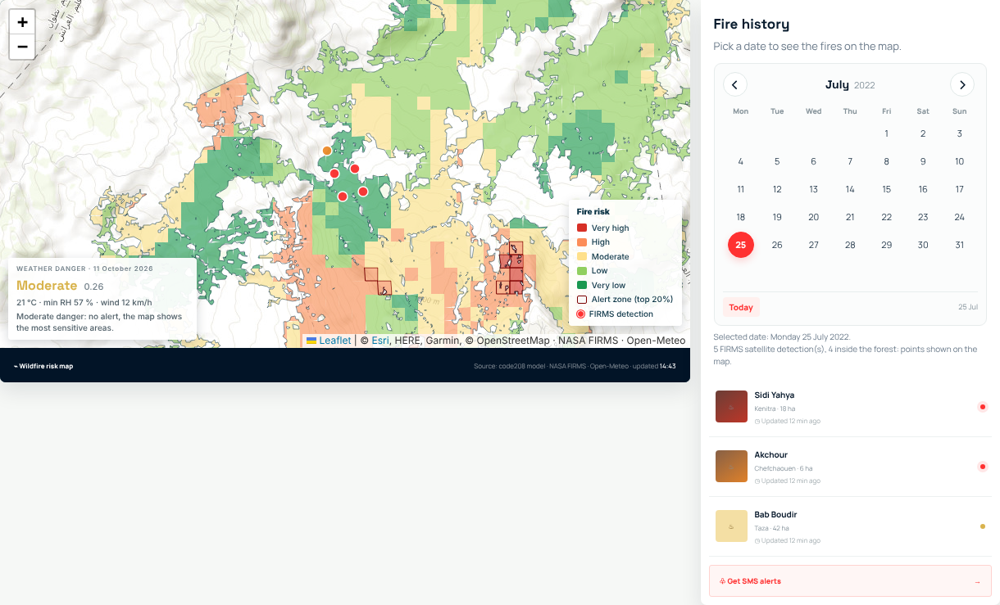 |

| Cell details | Alert sign-up | Arabic (right-to-left) |
|---|---|---|
| 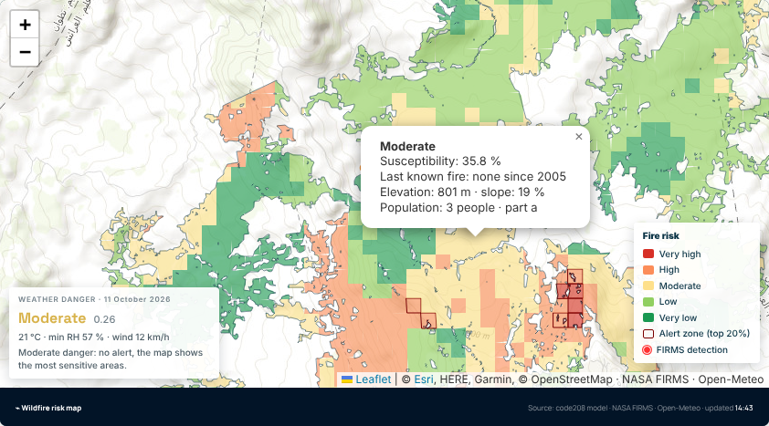 | 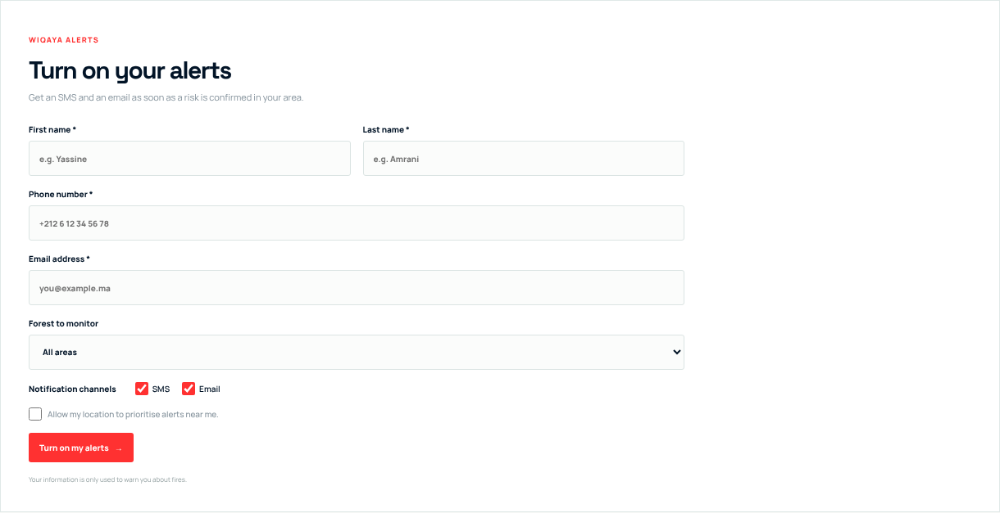 | 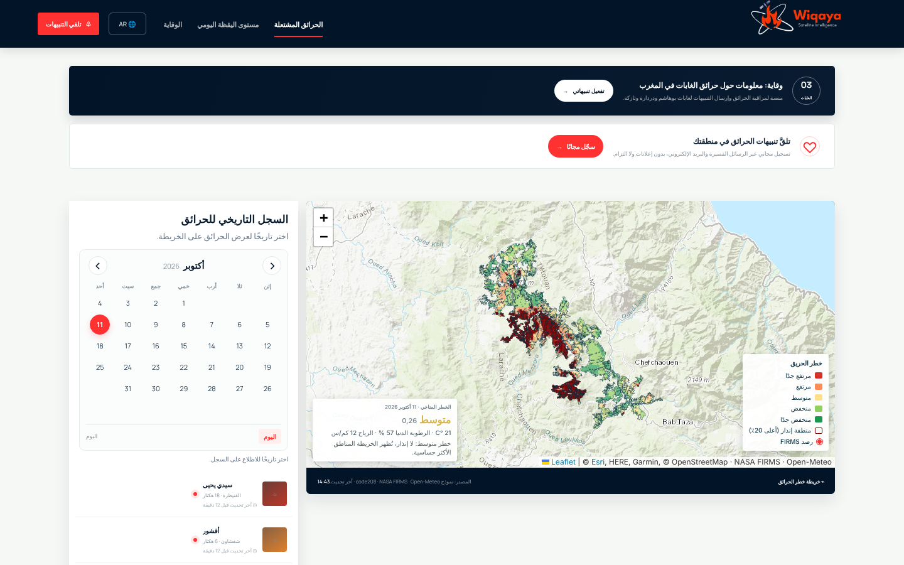 |

| Phone: home | Phone: risk map | Phone: fire history | Phone: alerts | Phone: Arabic |
|:---:|:---:|:---:|:---:|:---:|
| 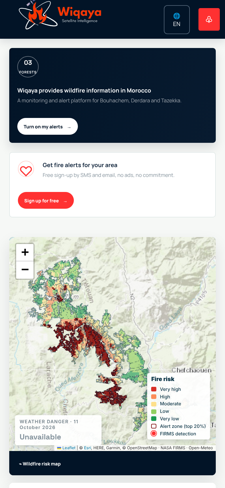 | 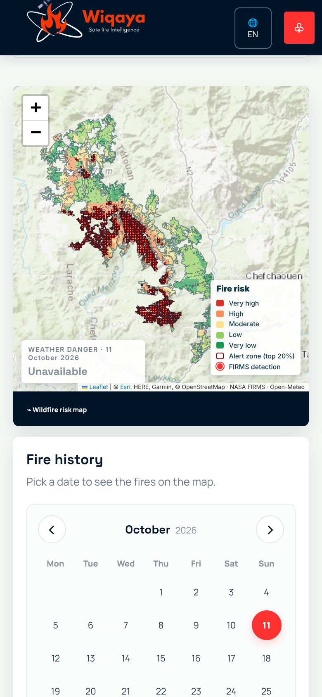 | 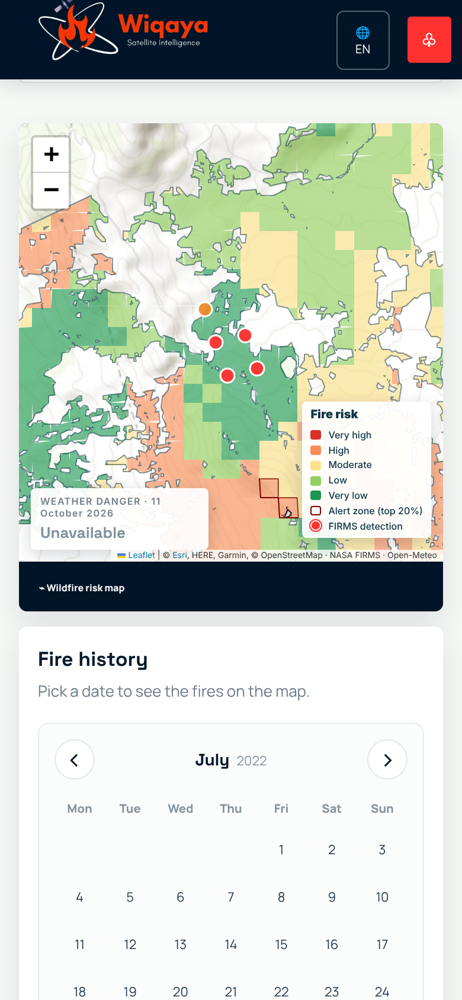 | 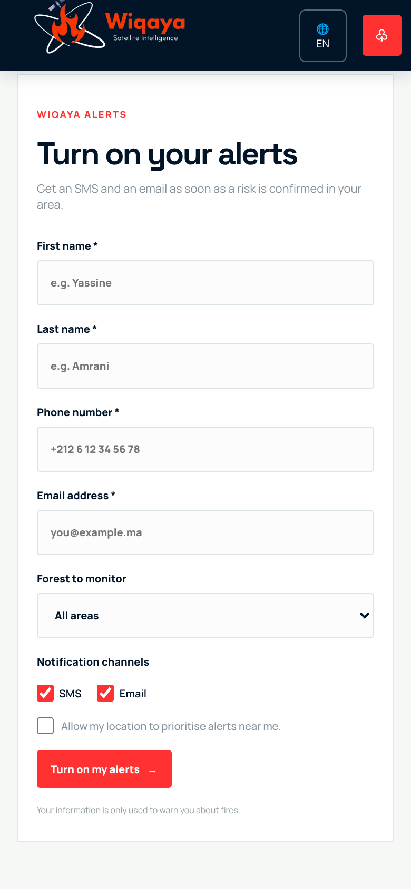 | 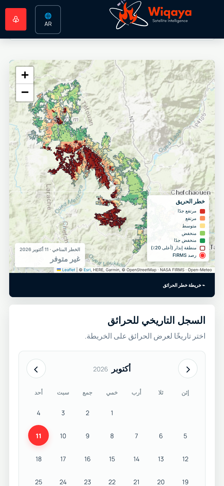 |

*In the phone screenshots, the weather box reads "Unavailable" because the weather service was rate-limiting the capture
machine. The desktop screenshots show the computed danger.*

## 8. Results and limitations

**Measured.** All values are reproduced by the notebook:

| Validation | Result |
|---|---|
| Leave-one-year-out 2017–2024, logistic regression (selected) | mean ROC-AUC per year **0.62**, global ROC-AUC 0.65, PR lift 1.64 |
| Leave-one-year-out 2017–2024, random forest | mean ROC-AUC per year 0.56, global ROC-AUC 0.60, PR lift 1.31 |
| ROC-AUC per held-out year (logistic regression) | 2017: 0.72 · 2018: 0.99 · 2019: 0.88 · 2020: 0.80 · 2021: 0.68 · 2022: 0.62 · 2023: 0.23 · 2024: 0.06 |
| **Blind test on the 2025 fires** (41 FIRMS points, 39 cells) | ROC-AUC **0.25**, no 2025 fire cell inside the top-20 % alert zones |

**Interpretation and where it breaks.**
- **Good on the big fire years.** The model ranks well the years with large fires (2018–2021).
- **Fails on recent fires.** It fails on 2023, 2024 and the 2025 blind test. The 2025 fires broke out in cells it rates as
  low risk (blue points in the headline figure).
- **Why.** The most important features are population, elevation and aspect, then fire history
  (`results/feature_importance.png`). They describe exposure, terrain and fire history, not **vegetation dryness or
  human access**, which drive where new fires start.
- **Small sample.** Only 345 positive cell-years exist: scores per year are unstable when a year has few fires.
- **Fuel rule effect.** The rule correctly removes recently burned cells, which pushes the risk towards long-unburned
  high ground.

In short, this PoC is a **working, reproducible pipeline**, not yet a reliable predictor.

**Next steps (incubation).**
1. Add the inputs of the research notebook to the reproducible pipeline:
   - land cover and flammability;
   - OpenStreetMap distances;
   - Sentinel-2 NDVI, NDMI and NBR from a daily batch job.
2. Add **hyperspectral fuel moisture and species maps** (EnMAP, Arab Satellite 813).
3. Validate on dNBR burned areas rather than FIRMS points.
4. Connect the alerts to an SMS gateway.
5. Pilot one fire season with the forest managers.

## 9. Team, licence and attribution

**Team Wiqaya, Morocco:**

| Member | Role |
|---|---|
| **Sanae BELFROUH** | AI model and its deployment on the website |
| **Wiame KANE** | Design and development of the AI model, geomatics |
| **Yassine AZMOU** | AI model, geomatics |
| **Mohammed Yassine SOF** | Web development |
| **Hajar ELOUATIQ** | Web development |

**Licence.** Code under the [MIT licence](LICENSE). Data keep their own licences (see [section 3](#3-data-used)).

**Attribution:**
- **NASA FIRMS** (MODIS C6.1 and VIIRS S-NPP 375 m active fires), https://earthdata.nasa.gov/firms.
- **FABDEM V1-2:** Hawker, L., Uhe, P., Paulo, L., Sosa, J., Savage, J., Sampson, C. and Neal, J. (2022), *A 30 m global map of elevation with forests and buildings removed*, Environ. Res. Lett. 17, 024016. Data: University of Bristol, https://doi.org/10.5523/bris.s5hqmjcdj8yo2ibzi9b4ew3sn, CC BY-NC-SA 4.0 (based on the Copernicus GLO-30 DEM).
- **WorldPop**, www.worldpop.org, University of Southampton, Morocco 2017 population counts, CC BY 4.0.
- **Open-Meteo** (Zippenfeld, P., *Open-Meteo.com Weather API*), CC BY 4.0. Its archive is based on ERA5:
  Hersbach, H. et al. (2020), *The ERA5 global reanalysis*, Q. J. R. Meteorol. Soc. 146, 1999–2049.
- **Copernicus Sentinel-2:** contains modified Copernicus Sentinel data 2015–2025.
- **Landsat Collection 2:** courtesy of the U.S. Geological Survey.
- **Microsoft Planetary Computer**, for Sentinel-2 and Landsat access.
- **© OpenStreetMap contributors** (ODbL). Esri World Topo Map and OpenTopoMap for the platform's background map.
- **Topoclimate method:** Assali, F. et al. (2016), forest-fire risk mapping in the Chefchaouen-Ouazzane region, Morocco.
- **Libraries:** GeoPandas, Rasterio, rasterstats, scikit-learn, FastAPI and Leaflet.

### Repository structure

```
├── README.md
├── requirements.txt                 pinned versions (Python 3.11)
├── LICENSE
├── notebooks/
│   └── 02_main_analysis.ipynb       reproducible main analysis, committed with its outputs
├── data/sample_input/               example input clipped to the AOI (8.4 MB)
├── results/                         example output written by the notebook
├── src/wiqaya_model.py              model code used by the notebook and the platform
├── research/                        full research notebook (code208)
├── server/                          optional web platform: FastAPI server
├── website/                         optional web platform: HTML / CSS / JS, English / French / Arabic
└── docs/                            slides, screenshots, model-inputs documentation
```
