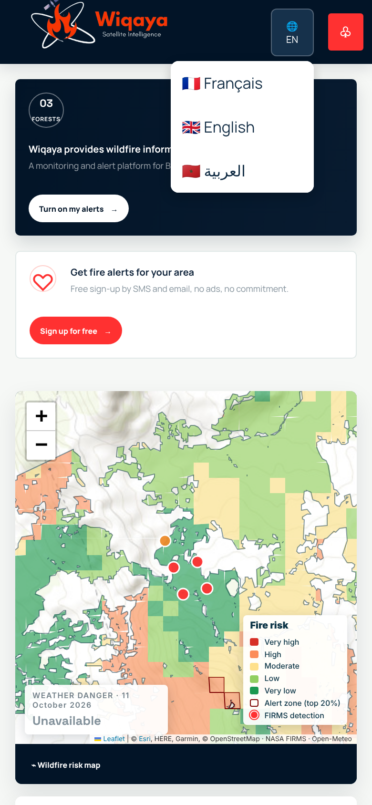
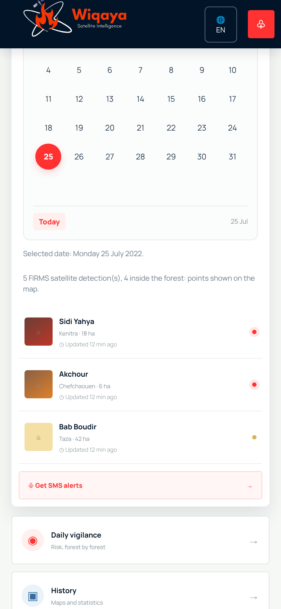
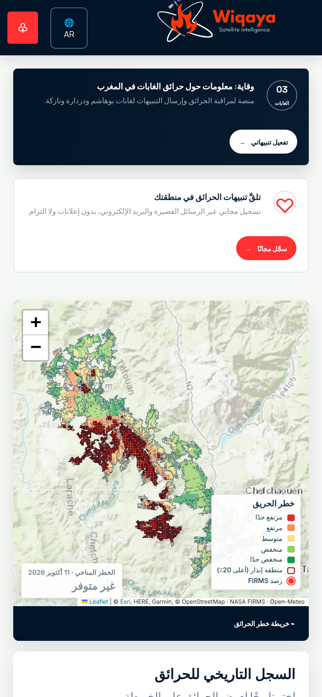

# Wiqaya — Wildfire risk monitoring for Moroccan forests

> **Arab Youth Space Hackathon 2026 · Proof of Concept**
> Track: **Climate & Disaster Resilience** · Study area: Bouhachem, Derdara and Jbel Sougna forests (Rif, northern Morocco)

**Wiqaya** (وقاية, *"prevention"*) turns Earth-observation data into a daily, cell-by-cell wildfire risk map
and citizen alerts for the forests of the western Rif.
- **Inputs:** NASA FIRMS satellite fire detections, Sentinel-2 and Landsat imagery, terrain, population and weather.
- **Model:** a machine-learning fire-risk model trained on documented fires.
- **Output:** a web platform in **English, French and Arabic**.


**Contents**
1. [Problem definition](#1-problem-definition)
2. [Solution and product](#2-solution-and-product)
3. [Earth-observation data](#3-earth-observation-data)
4. [Methodology and technical robustness](#4-methodology-and-technical-robustness)
5. [Innovation](#5-innovation)
6. [Impact and strategic alignment](#6-impact-and-strategic-alignment)
7. [Commercial viability](#7-commercial-viability-brief-business-plan)
8. [Run the proof of concept](#8-run-the-proof-of-concept)
9. [Data sources and citations](#9-data-sources-and-citations)
10. [Repository structure](#10-repository-structure)
11. [Team](#11-team)

---

## 1. Problem definition

The Mediterranean forests of the western Rif burn almost every summer. Hot, dry easterly winds (*chergui*),
steep slopes and villages (*douars*) inside the forest make the fires fast and dangerous.

**Recent fires in and around the study area** (dates and areas compiled in the research notebook):

| Fire | Dates | Burned area |
|---|---|---|
| Bouhachem | 25 Jul – 2 Aug 2022 | > 7,500 ha |
| Sahel El Menzla / Larache, neighbouring forest | 13–18 Jul 2022 | > 10,500 ha |
| Derdara / Jbel Sougna | 14–18 Aug 2021 | ~ 1,100 ha |
| Bouhachem | 25 Aug – 1 Sep 2020 | ~ 1,100 ha |
| Two fires in Derdara / Bouhachem | Aug 2025 | blind test of the model |

**People exposed:** WorldPop 2017 counts about **10,600 inhabitants inside the forest** and
**264,000 within 10 km of it**.

**The gap:**
- Forest managers and residents have no **local, daily and public** view of where the risk is highest.
- National fire-danger bulletins work at province scale.
- Satellite fire detections arrive only **after** ignition.
- Alerts are not delivered in the languages people use (Arabic, French).

## 2. Solution and product

Wiqaya is a web platform backed by a fire-risk model. It answers two questions: **where** in the forest is
the risk highest, and **is today a dangerous day**.

| Feature | What it does |
|---|---|
| **Daily fire-risk map** | The forest is split into **6,071 cells of 250 m**. Each cell gets a fire susceptibility, shown in 5 risk classes. The 20 % riskiest cells are outlined as *alert zones*. Clicking a cell explains its score: susceptibility, years since the last fire, elevation, slope and population. |
| **Weather danger of the day** | Today's forecast (max temperature, min humidity, max wind, max vapour-pressure deficit) is ranked against every summer day of 2017–2024. This gives an index from 0 to 1 (low / moderate / high / very high). Alerts become operational when the danger is high or very high. |
| **Fire history** | Pick any date to see that day's **NASA FIRMS** satellite fire detections on the map (MODIS since 2005, VIIRS since 2017). |
| **Citizen alerts** | Residents subscribe to SMS and email alerts for their forest. |
| **3 languages** | English, French and Arabic, with a full right-to-left layout for Arabic. The site follows the browser language, and `?lang=en`, `?lang=ar` or `?lang=fr` can be added to any link. |
| **Open API** | The same data is available as GeoJSON for other tools (see [§8](#api)). |

| Risk map and weather danger | Fire history: 25 July 2022, start of the Bouhachem fire |
|---|---|
|  |  |

| Cell details | Alert sign-up |
|---|---|
|  |  |

**Arabic (right-to-left)**


### On the phone

The platform is responsive: the map, the calendar, the alert form and the three languages all work on a phone.

| Home | Risk map | Fire history (25 July 2022) | Alert sign-up |
|:---:|:---:|:---:|:---:|
|  |  |  |  |

| Language menu | Calendar | Arabic home | Arabic map |
|:---:|:---:|:---:|:---:|
|  |  |  |  |

*When the phone screenshots were taken, the weather service was rate-limiting the capture machine, so the
weather box shows "Unavailable". This is how the site behaves when the service does not answer. The
desktop screenshots show the computed danger.*

## 3. Earth-observation data

| Data | Sensor / product | Resolution | Used for |
|---|---|---|---|
| **Active fires** | NASA FIRMS: MODIS C6.1 (2005–2017) and VIIRS S-NPP 375 m (2017–2026) | 1 km / 375 m | Fire labels, fire-history features (years since last fire), map of past detections |
| **Optical imagery** (research notebook) | Sentinel-2 L2A: B04, B08, B11, B12 | 10–20 m | NDVI, NDMI and NBR vegetation indices; dNBR burned-area labels (2019–2025 fires) |
| **Optical imagery** (research notebook) | Landsat Collection 2 Level-2: red, nir08, swir16, swir22 | 30 m | Same indices for the fires before 2015 (2005, 2009) |
| **Terrain** | Digital elevation model, reprojected to EPSG:26191 | ~ 30 m | Elevation, slope, aspect, topoclimate |
| **Land cover** (research notebook) | 2021 land-cover classification of the study area | 10 m | Fuel type and flammability |
| **Population** | WorldPop 2017 (`mar_ppp_2017`), clipped and reprojected | 100 m | Human exposure and pressure |
| **Weather** | Open-Meteo forecast and ERA5-based archive | point at the forest centre | Daily weather danger, 2017–2024 summer climatology |
| **Human access** (research notebook) | OpenStreetMap 2022: roads, tracks, buildings, villages, farmland | vector | Distance-based human pressure |

**Hyperspectral data:** not used in this PoC. It is the next step in the roadmap: EnMAP or Arab Satellite 813
scenes could map **live fuel moisture** and **vegetation species** at cell level. Those are the two variables
the current multispectral indices capture only indirectly.

## 4. Methodology and technical robustness

### 4.1 Research model ([`model/code208_risque_feu_autonome.ipynb`](model/code208_risque_feu_autonome.ipynb))

The documented, reproducible notebook is run end to end with *Run all*, in about 1 h 30 to 3 h for the
first run. It works on one 250 m grid in Merchich / Nord Maroc (EPSG:26191) and keeps two questions apart:

- **Where? A spatial model.**
  - It is trained only on fire days, comparing burned and unburned cells of the same day. This way the
    model learns *where* fires spread and does not just memorise *which days* were hot.
  - **Labels:** Sentinel-2 or Landsat **dNBR** (threshold 0.27, with a FIRMS mask and a check against the
    official burned area).
  - **Training fires:** 8 documented fires between 2005 and 2022.
  - **Blind test:** the two 2025 fires, never seen during training.
- **Which day? A weather danger index.** It is transparent rather than learned: with only 8 fire days, a
  learned "fire day" model would memorise those dates.
- **Yearly susceptibility map.** It is learned from FIRMS detections year by year, with **leave-one-year-out**
  validation, so the same fire is never both learned and evaluated.

The notebook uses **29 inputs**. Every variable and formula (NDVI, NDMI, NBR, flammability, the topoclimate
index of Assali et al. 2016, human pressure, fire history, VPD…) is documented in
[`docs/inputs_modele_risque_feu.pdf`](docs/inputs_modele_risque_feu.pdf) (in French; its file paths refer to the
original project layout).

### 4.2 Web model ([`server/modele.py`](server/modele.py))

The platform runs the parts of the notebook that work with the data in this repository, with the same
formulas and parameters:

| Step | Notebook | Platform |
|---|---|---|
| Single 250 m grid over the 6 forest parts | ✅ | ✅ 6,071 cells |
| Elevation, slope, aspect (DEM), population (WorldPop 2017) | ✅ | ✅ |
| Years since last fire + fuel rule (no fuel the year after a fire, half risk for 1 to 5 years) | ✅ | ✅ from FIRMS |
| Land cover and OpenStreetMap distances | ✅ | ❌ input files not in the repository yet |
| Sentinel-2 / Landsat indices, dNBR labels | ✅ | ❌ about 2 h of downloads, to be moved to a daily batch job |
| Yearly susceptibility model, leave-one-year-out validation | ✅ | ✅ the better of logistic regression and random forest |
| Weather danger index (Open-Meteo, 2017–2024 summers) | ✅ | ✅ |
| Daily map: 5 KMeans classes + top-20 % alert zones | ✅ | ✅ |

### 4.3 Evaluation

The scores are returned by the API in `resume.modele`:

| Test | Result |
|---|---|
| Leave-one-year-out validation, 2017–2024 | Mean ROC-AUC **0.62** per year, global ROC-AUC 0.65, PR lift 1.6. Logistic regression is selected. |
| Blind test on the 2025 FIRMS detections (model trained on 2017–2024) | ROC-AUC **0.25** |

The reduced platform model is a **working end-to-end pipeline, not yet a reliable predictor**. The 2025 fires
broke out in areas it ranks as low risk. Its strongest features (elevation, recent burns, aspect) describe
terrain and history, but not **vegetation dryness or human access**. Those come from the land-cover, OSM and
satellite inputs of the research notebook. Plugging them in is the first item of the roadmap.

### 4.4 Robustness and scalability

- **One grid, one projection.** Every layer is projected to EPSG:26191 and checked when loaded. Slope
  aspect is averaged circularly, so 355° and 5° give north, not south.
- **No data leakage.** Fire history is always computed strictly **before** the date being studied. Test
  years and test fires are never used for training or model selection.
- **Reproducible.** Seeds are fixed. The server caches its preparation and rebuilds it automatically
  when an input file changes (content hash).
- **Scalable.** Covering another forest only needs its boundary, a DEM and the FIRMS archive. The
  grid, the features, the model and the API are generic.
- **Degrades gracefully.** If the weather service is down, the map still works and the danger box says
  so.

## 5. Innovation

- **"Where" and "which day" are kept apart.** A per-cell spatial model and a transparent daily weather
  index replace a single black box. This avoids the usual trap where a model only learns "hot day = fire"
  and lights up the whole forest at once.
- **Fuel memory.** The years since the last fire, from 20 years of satellite detections, act as a fuel
  rule: an area that burned last year cannot burn again right away.
- **Local physics.** The topoclimate index (Assali et al., 2016) combines slope aspect with the day's wind
  direction to flag dry, wind-exposed slopes.
- **From satellite to citizen.** The same open-data pipeline feeds a risk map for forest managers, an
  open GeoJSON API and **trilingual SMS and email alerts** for residents, with a full right-to-left
  Arabic interface.

## 6. Impact and strategic alignment

| Goal | Contribution |
|---|---|
| **SDG 13 — Climate action** (13.1: resilience and adaptive capacity to climate hazards) | Daily risk and alerts in a region where heatwaves and *chergui* winds drive extreme fire seasons. |
| **SDG 15 — Life on land** (15.1, 15.2: conserve and sustainably manage forests) | Pre-positioning patrols and firebreak work where the risk is highest. |
| **SDG 11 — Sustainable cities and communities** (11.5: reduce losses from disasters) | Early warning for the ~10,600 people living inside the forest. |
| **Morocco** | Supports the national forest strategy *Forêts du Maroc 2020-2030* and the work of the national forestry agency (ANEF) and Civil Protection. |
| **Arab region** | The pipeline only needs open data (FIRMS, Sentinel-2, Landsat, DEM, WorldPop, Open-Meteo). It can be replicated in the Mediterranean forests of Algeria, Tunisia, Lebanon and Syria. |

## 7. Commercial viability (brief business plan)

| | |
|---|---|
| **Customers** | **B2G:** forestry agency (ANEF), regional directorates, Civil Protection, provinces and communes. **B2B:** insurers, forest-product cooperatives, tourism operators in forest areas. |
| **Value proposition** | A daily, cell-level risk map with an explanation for each cell, an API for existing GIS tools, and ready-to-use citizen alerts in Arabic and French. |
| **Revenue model** | **Subscription per protected area** for institutions (dashboard, API, alert dispatch, custom zones). **Free citizen alerts**, funded by the institutional contracts or by CSR partners. Paid add-ons: high-resolution and hyperspectral fuel mapping, post-fire burned-area reports. |
| **Cost structure** | Open data, so no imagery cost for the base service. A small cloud server and SMS fees per alert. Model maintenance and onboarding of new forests. |
| **Go-to-market** | 1) Pilot with the Rif forest managers on Bouhachem, Derdara and Jbel Sougna during one fire season. 2) Extend to the other Mediterranean forests of Morocco. 3) Replicate in other Arab countries through space agencies and civil-protection networks. |
| **Competitive edge** | Global services (FIRMS, EFFIS / GWIS) show fires and danger at coarse scale. Wiqaya adds **local, cell-level risk**, a **fuel memory**, and **alerts to residents in their language**. |

## 8. Run the proof of concept

You need Python 3.11 or newer and an internet connection, for the weather and the map background.

```bash
git clone https://github.com/SanaeBelfrouh/wiqayagit.git
cd wiqayagit
git checkout wiqaya-hackathon

python -m venv .venv
source .venv/bin/activate            # Windows: .venv\Scripts\activate
pip install -r server/requirements.txt

python server/app.py
```

Then open **http://localhost:8000**. The full-screen map is at **http://localhost:8000/carte.html**.

The first start prepares the model, which takes 3 to 5 minutes. It builds the grid, computes terrain
features, reads FIRMS and runs the validation. The result is cached in `server/cache/`, so later starts take
a few seconds.

The full research notebook is in [`model/`](model/). See [`model/README.md`](model/README.md).

### API

| Route | Returns |
|---|---|
| `GET /api/risque[?date=YYYY-MM-DD]` | Risk cells as GeoJSON (WGS 84): `susceptibilite`, `classe_risque` (1–5), `alerte_feu`, terrain and history fields. `resume` holds the weather danger, the model name, its validation and test scores and its feature importance. |
| `GET /api/feux?date=YYYY-MM-DD[&jours=N]` | NASA FIRMS detections within 5 km of the forest |
| `GET /api/foret` | Outline of the 6 forest parts |
| `POST /api/trpc/alerts.subscribe` | Alert sign-up used by the website form. Stored in `server/cache/inscriptions.jsonl`, which is not versioned. |

Environment variables:

| Variable | Default | Purpose |
|---|---|---|
| `PORT` | `8000` | Server port |
| `HOST` | `127.0.0.1` | Listening address |
| `WIQAYA_DATA` | `data` | Data folder |
| `WIQAYA_CACHE` | `server/cache` | Cache folder |

## 9. Data sources and citations

- **NASA FIRMS, MODIS.** MODIS Collection 6.1 active fire detections, distributed by NASA FIRMS, https://earthdata.nasa.gov/firms.
- **NASA FIRMS, VIIRS.** VIIRS S-NPP 375 m active fire detections (Collection 2), distributed by NASA FIRMS, https://earthdata.nasa.gov/firms.
- **Copernicus Sentinel-2.** Contains modified Copernicus Sentinel data (2015–2025), Sentinel-2 L2A, accessed through Microsoft Planetary Computer, https://planetarycomputer.microsoft.com.
- **Landsat.** Landsat Collection 2 Level-2 Surface Reflectance, courtesy of the U.S. Geological Survey, accessed through Microsoft Planetary Computer.
- **WorldPop.** WorldPop (www.worldpop.org), *Global High Resolution Population Denominators Project*, Morocco 2017 population counts (`mar_ppp_2017`), University of Southampton, CC BY 4.0. Clipped to the study area and reprojected to 100 m in EPSG:26191; totals are kept within 0.1 %.
- **Open-Meteo.** Zippenfeld, P. *Open-Meteo.com Weather API*, https://open-meteo.com, CC BY 4.0. The archive is based on ERA5: Hersbach, H. et al. (2020), *The ERA5 global reanalysis*, Q. J. R. Meteorol. Soc. 146, 1999–2049.
- **OpenStreetMap.** © OpenStreetMap contributors, ODbL, https://www.openstreetmap.org/copyright.
- **Map background.** Esri World Topo Map (Esri, HERE, Garmin, © OpenStreetMap contributors); fallback OpenTopoMap (CC BY-SA).
- **Topoclimate method.** Assali, F. et al. (2016), forest-fire risk mapping in the Chefchaouen-Ouazzane region, Morocco.
- **Forest boundaries, DEM and 2021 land cover.** GIS layers prepared by the team for the study area, in EPSG:26191.

The full WorldPop raster (268 MB) is over GitHub's 100 MB limit, so it is not stored here.

## 10. Repository structure

```
├── website/                            Web platform (HTML / CSS / JavaScript)
│   ├── index2.html                     Home page
│   ├── carte.html                      Full-screen risk map
│   ├── carte-risque.js / .css          Risk map (Leaflet)
│   ├── i18n.js                         English / French / Arabic translations
│   └── wiqaya.js / wiqaya.css          Page interactions and styles
├── server/                             Python server (FastAPI)
│   ├── app.py                          Website + API
│   ├── modele.py                       Fire-risk model used by the platform
│   └── requirements.txt
├── model/                              Full research notebook (code208) and how to run it
├── data/                               GIS inputs, all in EPSG:26191
│   ├── forest/limites_forets.shp       Forest boundaries (6 parts)
│   ├── dem/mnt_bouhachem.tif           Digital elevation model
│   ├── firms/                          NASA FIRMS fire detections (MODIS, VIIRS)
│   └── population/                     WorldPop 2017, clipped to the study area
└── docs/                               Screenshots and model-inputs documentation
```

## 11. Team

- **Sanae Belfrouh**
- **Wiame Kane**
